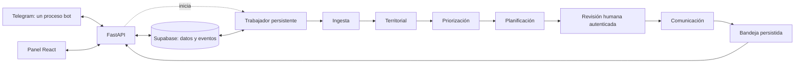

# RutaAgua Oeste

Reto: 1

Prototipo de apoyo a la coordinación de agua por cisternas en Panamá Oeste.
Convierte reportes en necesidades revisables, calcula prioridad y rutas y exige
aprobación humana antes de preparar avisos. Demo: seis puntos, dos cisternas y un depósito.

**Demandas, capacidades y recepción del ensayo son sintéticas.** Las coordenadas
del catálogo son referencias documentales; no acreditan acceso ni necesidad actual.
El prototipo no autoriza reparto operativo ni certifica calidad del agua.
Aviso enviado, recibido y agua entregada son hechos distintos.

## Equipo

- José Saavedra (@jos051225): cálculo, evaluaciones y documentación.
- Noel Echeverría (@NoelRevotn): API, panel, autorización y Telegram.
- Emilia Demercado (@Mochi-coder-star): contratos, geografía, agentes y persistencia.

## Arquitectura



Cinco agentes coordinados en código, con pausas explícitas por aclaración,
confirmación y revisión. Gemini interpreta; cuatro tools deterministas calculan:

| Tool | Función |
| --- | --- |
| `validate_need` | Valida evidencia y recepción; calcula demanda conservando faltantes. |
| `score_needs` | Política versionada: críticos primero, puntaje y desempate. |
| `solve_routes` | Cobertura y rutas con capacidad, ventanas, descarga y retorno. |
| `verify_plan` | Verifica propuesta y snapshot con lógica independiente del solver. |

El coordinador activo decide sobre la versión vigente. Cambiar entradas exige
recálculo y nueva aprobación. La huella identifica el snapshot; la API debe usar
el almacenado. Orden de llegada es un comparador, no una quinta tool.

## Tecnologías y datos

Python, Pydantic, OR-Tools, FastAPI, Supabase/Postgres/Auth, Gemini, Telegram y React/Vite.

- [Catálogo](datos/geografia/README.md): seis referencias documentales de Arraiján y La Chorrera.
- [Ensayo sintético actual](datos/escenario/oeste-1.0-ensayo-3/README.md): 15 000 L y supuestos explícitos.
- [Fuentes normativas](docs/referencias_normativas_panama.md): los pesos del proyecto no son porcentajes oficiales.
- [Decisiones](docs/decisiones.md): versiones, políticas y alcance.

## Instalación

Desde PowerShell:

```powershell
git clone https://github.com/HackathonFISC/equipo-03.git
cd equipo-03
py -3.12 -m venv .venv
.\.venv\Scripts\python.exe -m pip install -r requirements.txt
.\.venv\Scripts\python.exe -m pip check
.\.venv\Scripts\python.exe scripts/verificar_entorno.py
```

Python 3.12 es la referencia comprobada en la laptop de José, no una versión
obligatoria del equipo. Ver [entorno](docs/entorno_v0.md). El lock Python restringe
versiones; no es una imagen completa del sistema ni garantiza todo Python.

Copiar `.env.example` a `.env` y completar claves por canal privado. Revisar
[infraestructura](docs/infraestructura.md) para variables y migraciones antes de
iniciar servicios. No publicar `.env`, contraseñas ni tokens.

Desde `frontend/`, ejecutar `npm ci`. Se requiere Node compatible con Vite 8;
la auditoría local usó Node 24. Crear `frontend/.env` con `VITE_API_URL`,
`VITE_SUPABASE_URL` y `VITE_SUPABASE_ANON_KEY` según infraestructura.
La clave `service_role` corresponde solo al backend.

## Arranque

Con configuración y migraciones revisadas, tres terminales:

```powershell
# Terminal 1, raíz: API y trabajador automático
.\.venv\Scripts\python.exe -m uvicorn api.main:app --reload

# Terminal 2, raíz: un único bot por token
.\.venv\Scripts\python.exe -m bot.bot

# Terminal 3, carpeta frontend
npm run dev
```

Abrir `http://localhost:5173`. Procesar la cola consume los servicios configurados.
`GET /salud` comprueba la API y `/salud/agentes` el proceso local; ninguno demuestra
conectividad completa. Ctrl+C detiene cada proceso. No iniciar otro trabajador
manual con el modo automático activo.

Reportes y trazas se actualizan por sondeo. **La página Plan conserva ejemplos**;
Aprobación consulta planes persistidos. Confirmar el origen de cada vista antes
de la demo. Guías: [API](api/README.md), [bot](bot/README.md),
[panel](frontend/README.md) y [trabajador](orquestador/README.md).

## Pruebas y demos locales

Sin envío de mensajes ni escritura de planes remotos:

```powershell
.\.venv\Scripts\python.exe -m calculo.demo_v1
.\.venv\Scripts\python.exe -m calculo.demo_v2
.\.venv\Scripts\python.exe -m calculo.demo_plan_v3
.\.venv\Scripts\python.exe -m evals.comparar_v5
.\.venv\Scripts\python.exe -m pytest contratos/tests calculo/tests comun/tests api/tests bot/tests agentes/tests geografia/tests orquestador/tests evals/independientes -q
```

[V3](calculo/PLAN_V3.md) informa pendientes y déficit. [V5](evals/V5.md) compara
prioridad y antigüedad con las mismas entradas: en el retiro adverso, prioridad
cubre 2/2 críticos con 9000 L y el comparador 0/2 con 10 000 L. También se informa
el costo en déficit. Los tiempos locales no son latencias de atención ciudadana.

[Auditoría V6](docs/ENTREGA_V6.md), con salida nueva y Git disponible:

```powershell
.\.venv\Scripts\python.exe scripts/auditar_entrega.py --salida ../tmp/entrega_v6_01
```

Conserva copia candidata sin `.env`, manifiesto, regresión XML y comparación.
Usa paquetes instalados; no acredita instalación desde cero. Código 0: controles
locales aprobados; 1: fallo; 2: control pendiente. El [ejecutor V4](evals/V4.md)
conserva salida 2 mientras falta integración.

## Estado y límites

Cuatro tools, demos, comparación V5 y evaluaciones preparatorias implementadas.
El cierre V4/V5 y los tres recorridos reales V6 requieren evidencia conjunta de
aprobación vigente, aviso recibido y escenario adverso. `AVISOS_ACTIVOS` permanece
desactivado en d35d80e; Noel gestiona su activación tras validar prerrequisitos.

Límites: seis puntos, dos vehículos, un depósito, una salida por vehículo, demanda
indivisible, sin recargas ni tráfico vivo. El verificador comprueba restricciones,
no optimalidad. Datos desconocidos siguen pendientes. Envíos inciertos requieren
revisión, sin reintento ciego.

## Uso de IA y entrega

[Bitácora consolidada](docs/bitacora_ia/BITACORA_IA.md): fuentes literales de
[José](docs/bitacora_ia/jose.md), [Emilia](docs/bitacora_ia/emilia.md) y
[Noel](docs/bitacora_ia/noel.md), con hashes. Distingue uso de herramientas,
resultados locales y revisión humana. Regenerar si cambia una fuente.

[Lista V6](docs/ENTREGA_V6.md): instalación nueva, tres recorridos consecutivos
con uno adverso, acceso de evaluadores y ensayo de exposición de 6 min 30 s
(máximo siete). El equipo publica `final-24h` sobre la versión final validada y
conserva comprobante de envío; la auditoría no realiza esos pasos.
