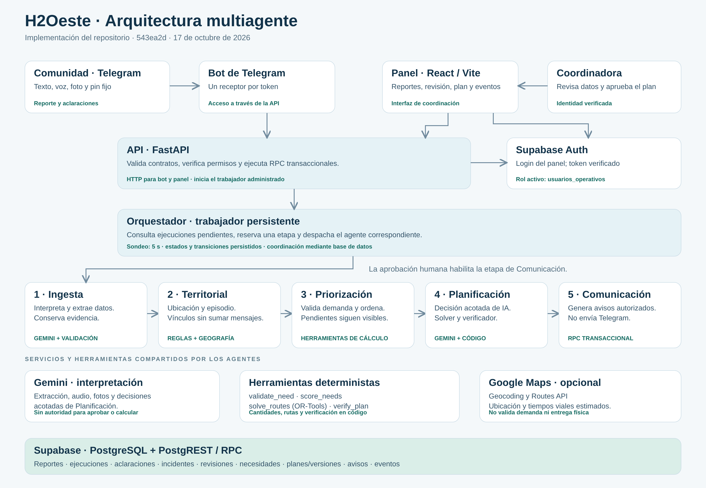
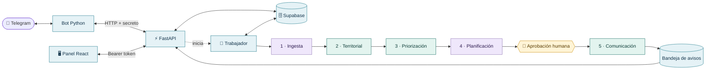
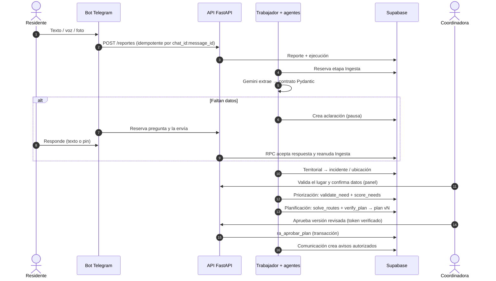

<div align="center">

# 💧 H2Oeste

### Sistema de Coordinación y Logística de agua por cisternas para Panamá Oeste

**Reportes ciudadanos por Telegram → necesidades revisadas → rutas verificadas → aprobación humana → avisos autorizados**


</div>

---

## 📑 Contenido

1. [El problema](#-el-problema)
2. [La solución](#-la-solución)
3. [Arquitectura de agentes](#️-arquitectura-de-agentes)
4. [Los cinco agentes y las cuatro tools](#-los-cinco-agentes-y-las-cuatro-tools)
5. [Recorrido de un reporte](#-recorrido-de-un-reporte)
6. [Humano en el ciclo, guardrails y trazabilidad](#️-humano-en-el-ciclo-guardrails-y-trazabilidad)
7. [Tecnologías](#-tecnologías)
8. [Fuentes de datos](#-fuentes-de-datos)
9. [Instalación local](#-instalación-local)
10. [Ejecución](#️-ejecución)
11. [Recorrido de demostración](#-recorrido-de-demostración)
12. [Evals y pruebas](#-evals-y-pruebas)
13. [Estado actual y límites](#-estado-actual-y-límites)
14. [Estructura del repositorio](#-estructura-del-repositorio)
15. [Uso de IA y documentación](#-uso-de-ia-y-documentación)
16. [Equipo](#-equipo)

---

## 🚱 El problema

El crecimiento urbano de **Panamá Oeste**, sobre todo en **Arraiján y La Chorrera**, ha superado la capacidad de potabilización y distribución. Cuando hay mantenimientos, daños o baja producción, comunidades enteras pasan días sin agua y dependen de carros cisterna.

Hoy los reportes llegan dispersos por mensajería, redes sociales y llamadas, sin consolidarse:

| Síntoma | Consecuencia |
| --- | --- |
| 🔁 El mismo incidente se reporta muchas veces | Se confunde volumen de quejas con necesidad real |
| 📍 Ubicaciones vagas («cerca del chino de Vista Alegre»), voz y fotos | Nadie convierte el mensaje en un punto de atención accionable |
| ⚖️ Recibe primero quien más se queja | Un centro de salud o un hogar de adultos mayores puede esperar más que una barriada más visible |
| 🚚 Pocas cisternas, con capacidad y horario limitados | Rutas decididas sin datos ni verificación |
| 📢 Los residentes no saben si ni cuándo llegará el agua | Protestas, cierres de calles y desconfianza |

*(Planteamiento del Reto 1 de los retos oficiales de la Hackathon FISC AI Agents 2026.)*

---

## 💡 La solución

**H2Oeste** es un centro de coordinación multiagente que convierte mensajes ciudadanos en un **plan de distribución justo, verificable y explicable**, sin quitarle la decisión a la persona coordinadora.

<table>
<tr>
<td width="33%" valign="top">

### 📥 Percibe
Recibe por **Telegram** texto, **notas de voz**, **fotos** y **pines de ubicación**. Gemini interpreta y extrae datos con **salida estructurada validada por Pydantic**, conservando la evidencia textual de cada dato.

</td>
<td width="33%" valign="top">

### 🧠 Decide
Resuelve la ubicación contra un **catálogo geográfico** real, consolida reportes **sin sumar mensajes repetidos**, calcula demanda y prioridad con una **política versionada** y optimiza rutas con **OR-Tools**.

</td>
<td width="33%" valign="top">

### ✅ Actúa con control
Un **verificador independiente** revisa cada plan. La coordinadora autenticada **aprueba o rechaza** una versión concreta y solo entonces se generan **avisos autorizados** por sector.

</td>
</tr>
</table>

> [!IMPORTANT]
> **Regla de diseño:** el LLM interpreta; **el código calcula y verifica**. Ningún agente aprueba planes, inventa datos faltantes ni declara una entrega física de agua.

### Qué lo diferencia de un chatbot

| Un chatbot con un buen prompt | H2Oeste |
| --- | --- |
| Responde texto | **Persiste** reportes, ejecuciones, incidentes, necesidades, planes, aprobaciones, avisos y eventos en Supabase |
| Estima cantidades «de memoria» | `validate_need` y `score_needs` calculan con fórmulas y política versionada; lo desconocido queda **pendiente**, nunca en cero |
| Sugiere rutas | `solve_routes` (OR-Tools) respeta **capacidad, ventanas de tiempo, descarga y retorno**; `verify_plan` las comprueba con lógica independiente |
| Cuenta quejas | **Un incidente no gana prioridad por recibir más mensajes** |
| Decide solo | Aprobación humana **ligada a la versión de datos y política revisada**; un cambio posterior **invalida** el plan |
| Sin memoria de decisiones | Cada decisión queda en una **traza** con agente, herramienta, resultado y duración |

---

## 🏗️ Arquitectura de agentes

<p align="center">
  
</p>

<p align="center"><sub>Diagrama de arquitectura sobre la base de código <code>543ea2d</code> (17 de octubre de 2026). Versión vectorial: <a href="docs/arquitectura/h2oeste_arquitectura.svg"><code>docs/arquitectura/h2oeste_arquitectura.svg</code></a>.</sub></p>

### Componentes

| Componente | Responsabilidad y conexión |
| --- | --- |
| 💬 **Telegram + bot Python** | Recibe texto, audio, fotos y respuestas; transporta preguntas de aclaración y avisos. **Solo habla con la API** mediante un secreto compartido: no tiene claves de Supabase ni llama a Gemini. |
| 🖥️ **Panel React / Vite** | Reportes, Necesidades (revisión y validación del lugar), Plan, Aprobación y Eventos. Login con Supabase Auth. |
| ⚡ **API FastAPI** | Valida contratos, verifica la identidad desde el token y el rol de coordinador, y ejecuta **RPC transaccionales**. Inicia y supervisa el trabajador de agentes en su ciclo de vida. |
| 🔁 **Orquestador (trabajador persistente)** | Sondea la cola de ejecuciones cada 5 s, **reserva** una etapa y despacha el agente correspondiente. La coordinación entre agentes ocurre por **estado persistido**. |
| 🗄️ **Supabase (PostgreSQL + PostgREST + Auth)** | Estado, relaciones, historial, permisos (RLS / `service_role`), reservas e idempotencia. |
| ✨ **Gemini** | Extracción estructurada, transcripción de audio, descripción de fotos y la decisión acotada de Planificación. **Sin autoridad para aprobar ni calcular.** |
| 🧮 **Cálculo Python / OR-Tools** | Demanda, prioridad, rutas y verificación independiente. |
| 🗺️ **Google Maps (opcional)** | Geocodificación y matriz de tiempos viales (Routes API). Los tiempos son estimaciones. |



<sub>🟪 usa Gemini · 🟩 reglas, herramientas y RPC · 🟨 decisión humana · 🟦 infraestructura</sub>

> [!NOTE]
> **Naturaleza multiagente.** Son cinco agentes funcionales con roles separados, coordinados mediante ejecuciones y resultados persistidos; no cinco conversaciones LLM independientes. El orquestador es un proceso Python, no un LLM supervisor. Ingesta y Planificación usan Gemini; Territorial, Priorización y Comunicación usan reglas, herramientas y RPC.

---

## 🤖 Los cinco agentes y las cuatro tools

| # | Agente | Entrada | Decisión y trabajo | Salida persistida |
| :-: | --- | --- | --- | --- |
| 1 | **Ingesta** <br>`agentes/ingesta.py` | Reporte y respuestas previas, con procedencia del texto (escrito, transcripción, descripción de imagen) | Extrae ubicación declarada, problema y datos respaldados por frases del mensaje; marca faltantes, fuera de alcance o necesidad de aclaración | Interpretación validada, evidencias, evento y siguiente etapa |
| 2 | **Territorial** <br>`agentes/territorial.py` | Interpretación, catálogo, pines e incidentes | Resuelve ubicación y episodio; vincula reportes compatibles, conserva conflictos y pide aclaración si es ambiguo | Incidente y vínculos, o ubicación resuelta del reporte |
| 3 | **Priorización** <br>`agentes/priorizacion.py` | Necesidad consolidada, revisión humana vigente y política | Invoca `validate_need` y `score_needs`; no multiplica población ni litros por número de mensajes | Demanda validada o pendiente, puntaje, posición y motivos |
| 4 | **Planificación** <br>`agentes/planificacion.py` | Necesidades revisadas, flota, depósito, ventanas y matriz | Gemini decide **calcular o pedir revisión**; el código invoca `solve_routes` y después `verify_plan` | Propuesta, rutas/paradas, informe de verificación, snapshot y versión |
| 5 | **Comunicación** <br>`agentes/comunicacion.py` | Plan **aprobado**, vigente y seleccionado por sector | Comprueba autorización, destinatarios y vigencia; crea avisos por punto/destino sin duplicar | Bandeja de avisos, cierre idempotente y trazas |

### 🧮 Tools deterministas (código, no LLM)

| Tool | Módulo | Qué hace |
| --- | --- | --- |
| `validate_need` | `calculo/demanda.py` | Valida evidencia y capacidad de recepción; calcula la demanda **conservando faltantes** (un dato ausente no se convierte en cero). |
| `score_needs` | `calculo/prioridad.py` | Política versionada: **críticos primero**, luego puntaje dentro de cada clase y desempate visible. |
| `solve_routes` | `calculo/solver.py` → `solver_v3.py` | OR-Tools: cobertura y rutas con capacidad, ventanas de tiempo, tiempo de descarga, disponibilidad y retorno al depósito. |
| `verify_plan` | `calculo/verificador.py` | Verifica la propuesta y su snapshot con **lógica independiente del solver**. Comprueba restricciones, no optimalidad. |

**Política de prioridad del proyecto** (`docs/politica_prioridad_oeste.md`), dentro de cada clase:

$$\text{puntaje} = 40 \cdot V + 40 \cdot \min\left(\tfrac{\text{horas}}{168}, 1\right) + 20 \cdot \min\left(\tfrac{\text{personas}}{500}, 1\right)$$

`V` = vulnerabilidad confirmada (0 / 0.5 / 1). Un crítico confirmado va antes que cualquier general. Los pesos y topes son una **decisión técnica del proyecto apoyada en referencias panameñas**, no una fórmula oficial (ver `docs/referencias_normativas_panama.md`).

---

## 🔄 Recorrido de un reporte



1. **Captura.** El bot recibe un mensaje admitido. Audio y fotos pasan por servicios de la API que obtienen texto y conservan su procedencia; **el archivo original no se guarda**.
2. **Interpretación.** Ingesta valida la salida estructurada y guarda evidencia. Si faltan datos, crea una **aclaración** y pausa.
3. **Aclaración.** La respuesta se valida por chat, pregunta, autor e identificador; una RPC la guarda y reanuda Ingesta en la misma operación. Plazo de 30 minutos.
4. **Resolución territorial.** Un punto del catálogo entra al circuito de incidentes; un pin o geocodificación aceptados localizan el reporte. Si no hay coincidencia única, se pide referencia o pin.
5. **Revisión y prioridad.** La coordinadora valida el lugar y confirma los insumos; las tools calculan demanda y orden. Lo desconocido permanece pendiente.
6. **Puente a planificación.** `puentes_necesidades_v3` enlaza necesidades persistidas con el escenario, conservando procedencia y versiones.
7. **Propuesta y verificación.** Matriz vial (opcional), solver y verificador; se guarda el plan con snapshot e informe.
8. **Decisión humana.** Aprobar o rechazar mediante API/RPC. Aprobar no equivale a enviar: también se requiere plan vigente por sector y destino autorizado.
9. **Comunicación.** Se generan avisos en la bandeja; el bot los reserva y registra `enviado`, `fallido` o `incierto`. Un acuse del proveedor **no acredita entrega física de agua**.

---

## 🛡️ Humano en el ciclo, guardrails y trazabilidad

| Requisito del reto | Cómo se cumple en H2Oeste |
| --- | --- |
| **≥ 3 agentes con roles distintos** | 5 agentes con etapas separadas y despacho en `orquestador/flujo.py` |
| **Herramientas que actúan** | Escritura transaccional en Supabase (RPC), solver OR-Tools, envío por Telegram vía bandeja |
| **Componente determinístico** | Demanda, prioridad, rutas y verificación en `calculo/` |
| **Humano en el ciclo** | Validación del lugar, confirmación de datos, aprobación/rechazo de una versión concreta con reconocimiento explícito de cada bloqueo |
| **Trazabilidad** | Tabla `eventos` + página **Eventos** del panel: agente o persona, decisión, herramienta, resultado, duración y estado |
| **Evals propios (≥ 15 casos)** | Dataset de **30 casos PED** + comparación V5 + suites de regresión (ver [Evals](#-evals-y-pruebas)) |
| **Guardrails** | Ver lista siguiente |

**Guardrails implementados**

- 🔐 La identidad de quien aprueba sale del **token verificado** y exige rol activo en `usuarios_operativos`; el navegador no puede elegirla en el cuerpo de la petición.
- 🔑 `SUPABASE_SERVICE_ROLE_KEY`, Gemini y Google permanecen en el servidor; el navegador solo usa configuración pública (`VITE_*`).
- 🧾 El texto ciudadano es **dato no confiable**: la IA debe devolver un contrato, respaldar la extracción con evidencia y no puede aprobar, alterar restricciones ni saltarse el verificador.
- 🖼️ Las imágenes **no acreditan** población, duración, vulnerabilidad, coordenadas ni prioridad.
- 0️⃣ Un dato ausente **no se reemplaza por cero**; los casos pendientes conservan su motivo.
- 🔁 Idempotencia: deduplicación por `chat_id:message_id`; unicidad de aviso por `plan:versión:sector:punto:destino:tipo`.
- ♻️ Un cambio relevante de entradas **invalida** el plan aprobado y cancela avisos pendientes no reservados.
- 🚫 Envíos inciertos o reservas vencidas van a revisión: **sin reenvío automático**.
- 🚦 Modo público del bot con límites por persona (8) y totales (120) cada 10 minutos para proteger la cuota del modelo; modo de prueba restringido a chats autorizados.
- 🧪 Los planes sintéticos solo pueden comunicarse a **destinos de ensayo** explícitamente habilitados y autorizados.

---

## 🧰 Tecnologías

| Capa | Tecnología | Versión comprobada |
| --- | --- | --- |
| Lenguaje backend | Python | 3.12 (Windows 64 bits y macOS arm64) |
| API | FastAPI + Uvicorn | 0.143.3 / 0.54.0 |
| Contratos | Pydantic | 2.14.1 |
| Optimización | Google OR-Tools | 9.15.6755 |
| Modelo | Gemini (REST vía `httpx`, salida JSON con esquema) | modelo por defecto en código: `gemini-3.8-flash` (configurable con `GEMINI_MODEL`) |
| Persistencia y Auth | Supabase (PostgreSQL, PostgREST, Auth) — cliente `supabase` | 2.33.0 |
| Mensajería | python-telegram-bot | 22.8 |
| Panel | React + Vite | 19 / 8 (Node 24 en la auditoría local) |
| Mapas (opcional) | Google Geocoding, Routes y Maps Embed API | — |
| Pruebas | pytest, `node --test` | 9.1.1 |

Versiones exactas en [`requirements-lock.txt`](requirements-lock.txt) y [`frontend/package-lock.json`](frontend/package-lock.json).

---

## 📊 Fuentes de datos

| Fuente | Uso en el proyecto | Carácter |
| --- | --- | --- |
| [AIG — Puntos de acceso de la Red Nacional de Internet, enero 2022 (Datos Abiertos Panamá)](https://datosabiertos.gob.pa/dataset/2e947382-70dd-46a5-9fcb-6fe2f466ca9c/resource/5ba77e85-3b95-4737-bd05-9599da74a320/download/aig-puntos-de-acceso-de-la-rni2.0-vigentes-en-enero2022.pdf) | Catálogo `oeste-1.0`: 6 instalaciones (3 en Arraiján, 3 en La Chorrera) con nombre, corregimiento y coordenadas — [`datos/geografia/`](datos/geografia/README.md) | 🟢 Referencia documental real; **no acredita** desabastecimiento ni acceso de cisterna |
| [OMS — agua en emergencias humanitarias](https://www.who.int/teams/environment-climate-change-and-health/water-sanitation-and-health/environmental-health-in-emergencies/humanitarian-emergencies) | ~20 L/persona/día para cobertura doméstica básica en el ensayo | 🟡 Referencia de escala |
| ASEP AN 1480-Agua, DGNTI-COPANIT 21-2019, ASEP JD-1410, Decreto 69-2017 | Requisitos de operación y calidad fuera del puntaje — [`docs/referencias_normativas_panama.md`](docs/referencias_normativas_panama.md) | 🟡 Marco normativo consultado |
| Normas técnicas IDAAN (ANTAI), MINSA, operativo IDAAN 2026 (SERTV) | Apoyo a hipótesis de tamaño de familia, tanque de referencia y criterios de criticidad | 🟡 Apoyo documental |
| [Ensayo sintético 3](datos/escenario/oeste-1.0-ensayo-3/README.md) | 860 personas ficticias, **15 000 L** netos, 2 cisternas de 10 000 L, 1 depósito | 🔴 **Sintético** — no describe operación real |
| Mensajes de Telegram | Reportes reales recibidos durante las pruebas | 🟢 Origen real, interpretado y revisado |

> [!WARNING]
> **Demandas, capacidades, recepción y flota del ensayo son sintéticas.** Las coordenadas del catálogo son referencias documentales. El prototipo **no autoriza reparto operativo ni certifica la calidad del agua**. Aviso enviado, aviso recibido y agua entregada son hechos distintos.

---

## 🧩 Instalación local

### Requisitos previos

| Requisito | Para qué |
| --- | --- |
| **Python 3.12** | Backend, agentes, bot y cálculo (3.14 no validado) |
| **Node.js** compatible con Vite 8 (se usó Node 24) | Panel |
| **Git** | Clonar el repositorio |
| Proyecto **Supabase** | Base de datos, RPC y login del panel |
| Clave de **Gemini API** (Google AI Studio) | Interpretación, audio, fotos y decisión de Planificación |
| Token de **bot de Telegram** (BotFather) | Canal ciudadano |
| *(Opcional)* Claves de **Google Maps** | Geocodificación, Routes API y mapa del panel |

### 1️⃣ Clonar

```bash
git clone https://github.com/HackathonFISC/equipo-03.git
cd equipo-03
```

### 2️⃣ Entorno Python

<details open>
<summary><b>🪟 Windows (PowerShell)</b></summary>

```powershell
py -3.12 -m venv .venv
.\.venv\Scripts\python.exe -m pip install -r requirements.txt
.\.venv\Scripts\python.exe -m pip check
.\.venv\Scripts\python.exe scripts/verificar_entorno.py
```

</details>

<details>
<summary><b>🍎 macOS (zsh/bash)</b></summary>

```bash
python3.12 -m venv .venv
.venv/bin/python -m pip install -r requirements.txt
.venv/bin/python -m pip check
.venv/bin/python scripts/verificar_entorno.py
```

Linux no se ha probado; los mismos comandos de macOS deberían aplicar.

</details>

`verificar_entorno.py` comprueba dependencias, contratos, escenario y el motor de OR-Tools **sin credenciales ni red**.

### 3️⃣ Variables de entorno del backend

```powershell
copy .env.example .env      # Windows
# cp .env.example .env      # macOS / Linux
```

| Variable | Obligatoria | Uso |
| --- | :-: | --- |
| `SUPABASE_URL` | ✅ | URL HTTPS del proyecto |
| `SUPABASE_SERVICE_ROLE_KEY` | ✅ | **Solo servidor.** Persistencia privilegiada |
| `SUPABASE_ANON_KEY` | ✅ | Verificación de sesión del panel en la API |
| `GEMINI_API_KEY` | ✅ | Interpretación de reportes |
| `GEMINI_MODEL` | — | Vacío usa el valor del adaptador |
| `GEMINI_AUDIO_MODEL` / `GEMINI_IMAGE_MODEL` | — | Vacíos reutilizan `GEMINI_MODEL` |
| `TELEGRAM_BOT_TOKEN` | ✅ | Solo el proceso bot |
| `API_SECRETO_BOT` | ✅ | Secreto compartido API ↔ bot (mínimo 16 caracteres) |
| `TELEGRAM_ACCESO_PUBLICO` | — | `true` abre el bot a cualquiera; vacío = modo de prueba |
| `TELEGRAM_CHAT_IDS_PRUEBA` | ⚠️ | Chats autorizados en modo de prueba (separados por coma) |
| `BOT_LIMITE_USUARIO` / `BOT_LIMITE_TOTAL` / `BOT_VENTANA_MINUTOS` | — | Límites del modo público (8 / 120 / 10 por defecto) |
| `API_URL` | — | Dirección de la API para el bot (`http://127.0.0.1:8000`) |
| `TZ` | — | `America/Panama` |
| `TRABAJADOR_AUTOMATICO` | — | `true` (por defecto): la API inicia el trabajador |
| `GOOGLE_MAPS_API_KEY` | — | Geocodificación (solo backend) |
| `GOOGLE_ROUTES_ACTIVAS` / `GOOGLE_ROUTES_API_KEY` | — | Tiempos viales en planificación |

> [!CAUTION]
> Nunca subir `.env`. Las claves se comparten por canal privado. `service_role`, el token de Telegram y la clave de Gemini **jamás** van en variables `VITE_`.

### 4️⃣ Base de datos Supabase

Ejecutar cada archivo **completo** en el *SQL Editor* de Supabase, **en este orden** (el número de archivo no es el orden de instalación: `0003` depende de `0009` y `0011`):

```text
0001_esquema.sql
seed/01_sectores_puntos.sql          ← catálogo de 6 puntos (requiere 0001)
0004_identidad_reportes.sql
0005_ingesta_transaccional.sql
0006_aclaraciones_v2.sql
0007_territorial_orquestador_v2.sql
0008_idempotencia_lotes.sql
0009_planificacion_v3.sql
0010_ensayos_priorizacion_v2.sql
0011_bandeja_salida.sql
0003_aprobacion.sql                  ← después de 0009 y 0011, antes de 0012
0012_comunicacion_v4.sql
0013_feedback_aclaraciones.sql
0014_recuperacion_trabajador.sql
0015_ingesta_recuperable.sql
0016_puente_necesidades_v3.sql
0017_lotes_confirmados_automaticos.sql
0018_localizacion_automatica.sql
0019_matriz_vial_planificacion.sql
0020_transcripciones_audio.sql
0021_validar_lugar.sql
0022_descripciones_imagen.sql
```

- Cada migración tiene su prueba en `supabase/tests/` (`*_smoke.sql`), que termina en `ROLLBACK`. Ejecutarlas en un entorno aislado. El guion `0003_concurrencia.sh` usa una base **desechable**.
- El número `0002` no existe en el repositorio.
- Detalle de dependencias y actualización de una base existente: [`supabase/migrations/README.md`](supabase/migrations/README.md).

**Cuenta de coordinación (credenciales de demo):**

1. Crear la cuenta en Supabase → *Authentication → Users* (no insertar en `auth.users` a mano).
2. Copiar su *User UID* en el arreglo `usuarios` de [`supabase/admin/registrar_coordinadores.sql`](supabase/admin/registrar_coordinadores.sql) y ejecutarlo. Esto crea la fila de coordinador activo en `usuarios_operativos`.
3. Usar ese correo y contraseña para entrar al panel. **Las credenciales no se publican en el repositorio**; se entregan por canal privado.

### 5️⃣ Panel (frontend)

```bash
cd frontend
npm ci
copy .env.example .env       # Windows  (cp .env.example .env en macOS/Linux)
```

| Variable (`frontend/.env`) | Uso |
| --- | --- |
| `VITE_API_URL` | `http://localhost:8000` |
| `VITE_SUPABASE_URL` | URL del proyecto |
| `VITE_SUPABASE_ANON_KEY` | Clave **pública** (anon) |
| `VITE_GOOGLE_MAPS_API_KEY` | *(Opcional)* Maps Embed API, restringida por referrer. Sin ella, el panel muestra coordenadas y un enlace a Google Maps |

---

## ▶️ Ejecución

Con configuración y migraciones listas, abrir **tres terminales**:

```powershell
# 🟦 Terminal 1 — raíz: API + trabajador de agentes (se inicia solo)
.\.venv\Scripts\python.exe -m uvicorn api.main:app --reload

# 🟩 Terminal 2 — raíz: bot de Telegram (UN solo proceso por token)
.\.venv\Scripts\python.exe -m bot.bot

# 🟪 Terminal 3 — carpeta frontend: panel
npm run dev
```

<sub>En macOS/Linux, reemplazar `.\.venv\Scripts\python.exe` por `.venv/bin/python`.</sub>

| URL | Qué muestra |
| --- | --- |
| http://localhost:5173 | Panel de coordinación (inicio de sesión) |
| http://localhost:8000/salud | Prueba de vida de la API → `{"estado":"ok"}` |
| http://localhost:8000/salud/agentes | Estado del proceso local del trabajador (`iniciado`, `desactivado`, `otra_instancia`, `fallido`, `finalizado`) |
| http://localhost:8000/docs | Documentación interactiva de FastAPI |

> [!TIP]
> - No iniciar un trabajador manual mientras `TRABAJADOR_AUTOMATICO=true`: la API ya lo administra.
> - Dos procesos del bot con el mismo token se roban los mensajes.
> - `Ctrl+C` detiene cada proceso; el trabajador termina su etapa actual (hasta 60 s).
> - `/salud` y `/salud/agentes` no demuestran por sí solos conectividad con Gemini, Supabase o Telegram.

---

## 🎬 Recorrido de demostración

1. **Telegram:** enviar `/start` al bot y luego un reporte, por ejemplo: *«Sin agua desde hace 48 horas en Escuela El Coco; somos 120 personas»*. También se puede enviar una **nota de voz** (hasta 2 min / 2 MiB) o una **foto** (hasta 5 MiB) con texto.
2. El bot responde con un **código de reporte**. Si faltan datos, envía una **pregunta de aclaración**; responder con texto o con un **pin fijo** (Adjuntar → Ubicación).
3. **Panel → Reportes:** ver la interpretación, los campos extraídos, las frases que los sustentan y la traza de agentes (se actualiza cada 5 s).
4. **Panel → Necesidades:** **Validar el lugar** del incidente (mapa + evidencia escrita) y **confirmar los datos** de cada punto con una política activa.
5. **Panel → Plan:** revisar rutas por cisterna, litros, puntos atendidos y no atendidos, y el resultado del **verificador**.
6. **Panel → Aprobación:** como coordinadora, reconocer cada bloqueo, escribir el motivo y **aprobar** o **rechazar** la versión.
7. **Panel → Eventos:** seguir de punta a punta qué agente o persona tomó cada decisión, con qué herramienta y resultado.

---

## 🧪 Evals y pruebas

### Evals propios

| Conjunto | Qué mide | Resultado registrado |
| --- | --- | --- |
| **Dataset PED de escritorio** — [`datos/entradas_prueba/escritorio_v1`](datos/entradas_prueba/escritorio_v1/README.md) | 30 casos: reportes completos, ubicación, duplicados, inyección, faltantes, recepción, exceso, retiro de cisterna, flota, ventanas, obsolescencia, rol, fallos, reinicio | **18/18 ejecutados aprobados**; 12 casos de integración pendientes (PED-07–12, PED-25–30) — [`informe.json`](evals/resultados/escritorio_v1/informe.json) |
| **Comparación V5** — [`evals/V5.md`](evals/V5.md) | Prioridad vs. orden de llegada con las mismas entradas, 5 escenarios sintéticos | En el retiro adverso de una cisterna: **prioridad cubre 2/2 críticos** (9000 L); el orden de llegada **0/2** (10 000 L). Se informa también el costo: 6000 L vs. 5000 L de déficit |
| **Fronteras de seguridad** — `evals/independientes/` | Rol sin permiso, encabezados falsificados, fallos del proveedor sin reenvío | Incluidas en la regresión |

### Regresión registrada

| Fecha (17/10/2026) | Resultado | Fuente |
| --- | --- | --- |
| Auditoría V6 | 715 pruebas Python + 66 subpruebas aprobadas | [`evals/resultados/v6_preparacion`](evals/resultados/v6_preparacion/README.md) |
| Dataset PED | 852 pruebas + 66 subpruebas aprobadas | [`evals/resultados/escritorio_v1`](evals/resultados/escritorio_v1/README.md) |
| Corrección Necesidades → Plan | **984 pruebas Python + 66 subpruebas**; **36 pruebas Node**; lint y build del panel correctos | [`docs/INCIDENCIAS_PLAN_20261017.md`](docs/INCIDENCIAS_PLAN_20261017.md) |

### Comandos (sin enviar mensajes ni escribir en servicios remotos)

```powershell
# Suite completa
.\.venv\Scripts\python.exe -m pytest contratos/tests calculo/tests comun/tests api/tests bot/tests agentes/tests geografia/tests orquestador/tests evals/independientes -q

# Panel
cd frontend; node --test tests; npm run lint; npm run build; cd ..

# Demos de cálculo
.\.venv\Scripts\python.exe -m calculo.demo_v1
.\.venv\Scripts\python.exe -m calculo.demo_v2
.\.venv\Scripts\python.exe -m calculo.demo_plan_v3

# Evals
.\.venv\Scripts\python.exe -m evals.escritorio --validar
.\.venv\Scripts\python.exe -m evals.escritorio --salida ../tmp/escritorio_resultados_01
.\.venv\Scripts\python.exe -m evals.comparar_v5
.\.venv\Scripts\python.exe -m evals.ejecutar --salida ../tmp/evaluacion_01
```

Las carpetas de `--salida` deben ser nuevas. Código de salida **2** = pendiente de integración (no es fallo); **1** = fallo.

---

## 📌 Estado actual y límites

**Comprobado en el repositorio**

- ✅ Cinco agentes, cuatro tools deterministas, orquestador persistente con recuperación acotada.
- ✅ Bot con texto, voz, fotos, pines, aclaraciones (activadas) y modo público con límites.
- ✅ Panel con login, Reportes, Necesidades (validación del lugar y revisión), Plan, Aprobación y Eventos.
- ✅ Recorrido sintético integrado hasta **Plan versión 1** persistido: 5100 L, dos puntos atendidos, una cisterna, verificador válido, matriz de Google Routes ([evidencia](docs/INCIDENCIAS_PLAN_20261017.md)).

**Pendiente o desactivado (declarado con transparencia)**

- ⏸️ El envío de **avisos de planes por Telegram** está desactivado en código (`AVISOS_ACTIVOS = False` en `bot/bandeja.py`); se activa tras validar prerrequisitos y destinos autorizados.
- ⏳ Los tres recorridos consecutivos de cierre V6 (incluido el adverso con retiro de cisterna y nueva aprobación) están documentados en [`docs/ENTREGA_V6.md`](docs/ENTREGA_V6.md) como pendientes de evidencia conjunta.

**Límites del modelo de la demo:** seis puntos, dos vehículos, un depósito, una salida por vehículo, demanda indivisible, sin recargas ni tráfico en vivo. El verificador comprueba restricciones, no optimalidad. No es una arquitectura de alta disponibilidad.

**Evolución propuesta:** más depósitos y recargas, entregas divididas, WhatsApp, validación con actores operativos (IDAAN / municipio) y política de prioridad aprobada por el operador.

---

## 🗂️ Estructura del repositorio

```text
equipo-03/
├── agentes/        # Ingesta, Territorial, Priorización, Planificación, Comunicación; adaptadores Gemini (texto, audio, imagen)
├── api/            # FastAPI: rutas, servicios, autenticación y errores
├── bot/            # Bot de Telegram, adaptador de aclaraciones, bandeja de avisos, límites
├── calculo/        # validate_need, score_needs, solve_routes (OR-Tools), verify_plan, comparador
├── comun/          # Configuración, cliente de base de datos, utilidades de audio e imagen
├── contratos/      # Modelos Pydantic, esquemas JSON y ejemplos compartidos
├── datos/          # Catálogo geográfico, escenarios sintéticos y dataset PED
├── docs/           # Decisiones, infraestructura, guías, bitácora de IA y arquitectura
├── evals/          # Ejecutores de evaluación, métricas y resultados
├── frontend/       # Panel React + Vite
├── geografia/      # Catálogo, resolución, consolidación y adaptadores de Google
├── orquestador/    # Servicio, trabajador y despacho de etapas
├── scripts/        # Verificación de entorno, auditoría de entrega y generadores
└── supabase/       # Migraciones, semillas, administración y pruebas SQL
```

---

## 📚 Uso de IA y documentación

| Documento | Contenido |
| --- | --- |
| [Bitácora de IA](docs/bitacora_ia/BITACORA_IA.md) | Consolidado de las bitácoras de [José](docs/bitacora_ia/jose.md), [Emilia](docs/bitacora_ia/emilia.md) y [Noel](docs/bitacora_ia/noel.md): herramienta usada, qué se generó y qué se revisó o modificó a mano |
| [Decisiones](docs/decisiones.md) | Registro de decisiones de arquitectura, versiones y alcance |
| [Infraestructura](docs/infraestructura.md) | Procesos, variables, migraciones y recuperación |
| [Arquitectura](docs/arquitectura/h2oeste_arquitectura.svg) | Diagrama de agentes, herramientas, flujos y punto de intervención humana |
| Guías por módulo | [API](api/README.md) · [Bot](bot/README.md) · [Panel](frontend/README.md) · [Orquestador](orquestador/README.md) · [Cálculo](calculo/README.md) · [Contratos](contratos/README.md) |
| Modalidades | [Audio](docs/AUDIO_TELEGRAM.md) · [Fotos](docs/IMAGENES_TELEGRAM.md) · [Localización automática](docs/LOCALIZACION_AUTOMATICA.md) · [Rutas Google](docs/RUTAS_GOOGLE.md) · [Validación del lugar](docs/VALIDACION_LUGAR.md) |

---

## 👥 Equipo

**Equipo 03 · Universidad Tecnológica de Panamá — Facultad de Ingeniería de Sistemas Computacionales**

| Integrante | GitHub | Responsabilidad |
| --- | --- | --- |
| **Emilia Demercado** | [@Mochi-coder-star](https://github.com/Mochi-coder-star) | Contratos, geografía, agentes y persistencia |
| **Noel Echeverría** | [@NoelRevotn](https://github.com/NoelRevotn) | API, panel, autorización y Telegram |
| **José Saavedra** | [@jos051225](https://github.com/jos051225) | Cálculo, evaluaciones y documentación |

<div align="center">

---

<sub>💧 H2Oeste — Hackathon FISC AI Agents 2026 · Reto 1: Agua · Panamá Oeste</sub>

</div>
